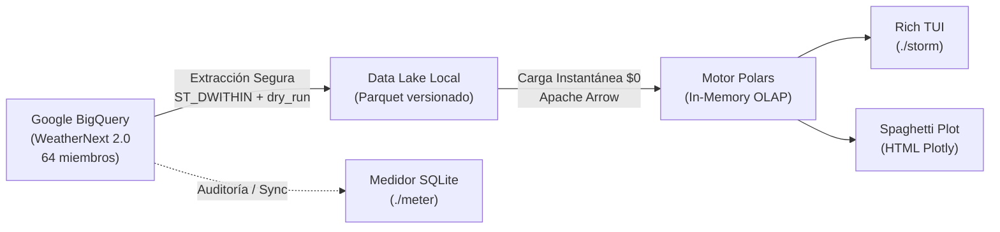

# WeatherNext Analytics Pipeline & Storm TUI 🌦️

[](https://www.python.org/)
[](https://github.com/astral-sh/uv)
[](https://pola.rs/)
[](https://rich.readthedocs.io/)
[](https://deepmind.google/)
[](references/features/README.md)

Pipeline meteorológico desacoplado, medidor de cuota a costo $0 USD y analizador sinóptico interactivo en terminal (TUI) basado en el ensamble neuronal de **64 miembros de Google DeepMind WeatherNext 2.0** en Google BigQuery.

---

## 🎯 1. Filosofía Arquitectónica y Propósito

La modelación numérica tradicional del clima (NWP) y las APIs genéricas (ej. Open-Meteo) sufren para capturar la dinámica caótica de eventos extremos (temporales severos, ríos atmosféricos y bloqueo orográfico en los Andes). Correr localmente modelos neuronales globales requeriría clusters masivos de GPUs/TPUs.

**WeatherNext** resuelve esto mediante una arquitectura desacoplada en tres etapas:



1. **Extracción Remota Segura**: Descarga controlada de tensores desde BigQuery con guardrails duros (`maximum_bytes_billed` y `dry_run` preventivo) hacia snapshots inmutables en disco (`data/weathernext_latest.parquet`).
2. **Blindaje de Cuota a Costo Cero ($0 USD)**: Medidor de doble entrada (`./meter`) con base SQLite local que rastrea cada megabyte consumido y concilia automáticamente contra `INFORMATION_SCHEMA.JOBS_BY_PROJECT` en GCP, protegiendo el límite mensual gratuito de **1.000 GB (1 TB)**.
3. **Análisis y Visualización Offline**: Carga columnar multi-hilo con Polars, interfaz visual en terminal con Rich (`./storm`) adaptativa (escritorio y celulares vía SSH), cálculo de percentiles P50/P90, probabilidades de lluvia, análisis de traslado diario (Commute) y Spaghetti Plots interactivos.

---

## 🕹️ 2. Interfaz Estandarizada A-Stack

Bajo la convención de verificación de la metodología **A-Stack**, interactúa con el sistema a través de herramientas CLI específicas:

### Diagnóstico de Salud y Cuota (Doctor / Info)
```bash
# Inspecciona el consumo del mes, estado del Free Tier y auditoría SQLite vs GCP:
./meter
```

### Ejecución y Análisis Sinóptico (Run / Feature)
```bash
# Pronóstico por defecto para Ñuñoa (Casa) en terminal de escritorio:
./storm

# Modo Celular / SSH móvil (pantallas estrechas <60 columnas en Termux/Prompt):
./storm --mobile

# Modo Traslado Diario (Commute) para evaluar hora punta Ñuñoa ⇄ Las Condes:
./storm --commute
# o en versión móvil:
./storm -m -c

# Presets de ubicación en la cuenca de Santiago:
./storm --trabajo      # Las Condes (Eje Apoquindo / Manquehue)
./storm --poniente     # Santiago Centro / Pudahuel / Maipú

# Extracción de la corrida más reciente publicada en BigQuery:
./storm --fetch

# Horizonte extendido de días o recorte de horas:
./storm --days 7
./storm -m --hours 48
```

### Inspección Offline de Snapshots (Inspection)
```bash
# Resumen estadístico y dimensiones de archivos Parquet en memoria:
uv run python explore_local.py

# Ver Spaghetti Plot interactivo generado:
open data/temporal_santiago.html  # o mediante túnel SSH / VS Code
```

---

## 🚀 3. Instalación y Configuración Rápida

### Requisitos Previos
* **Python >= 3.14**
* **[uv](https://github.com/astral-sh/uv)** (administrador de paquetes y runtime ultra-rápido)
* Proyecto en Google Cloud con acceso al dataset `weathernext_2` en Analytics Hub.

### 1. Clonar e Instalar Dependencias
```bash
git clone https://github.com/alvaro0o/weathernext.git
cd weathernext
uv sync
```

### 2. Autenticación con Google Cloud
Puedes autenticarte de dos maneras:

* **Opción A (Recomendada para desarrollo local - ADC)**:
  ```bash
  gcloud auth application-default login
  gcloud auth application-default set-quota-project TU_PROYECTO_GCP
  ```

* **Opción B (Servidores Headless / Desatendidos)**:
  Coloca tu llave de Service Account en `weathernext-runner.json` y asegúrate de referenciarla en `config.ini`:
  ```ini
  [GCP]
  credentials_file = weathernext-runner.json
  ```

### 3. Configuración (`config.ini`)
El archivo `config.ini` define los límites de seguridad y ubicación por defecto:
```ini
[GCP]
project_id = tu-proyecto-gcp
dataset = weathernext_2
table_name = weathernext_2_0_0

[LOCATION]
# Plaza Ñuñoa por defecto:
latitude = -33.4569
longitude = -70.5976
radius_meters = 25000

[SAFETY]
max_bytes_billed_mb = 750.0  # Tope duro de facturación
dry_run_only = False

[QUERY]
init_time = latest           # Auto-detecta la última corrida de BigQuery
```

---

## 📱 4. Modo Móvil para Terminales SSH (`--mobile` / `-m`)

Cuando te conectas vía SSH desde un teléfono móvil (utilizando clientes como **Termux**, **Prompt**, **JuiceSSH** o **Blink**), las pantallas verticales tienen típicamente entre **45 y 55 columnas de ancho**, provocando que las tablas convencionales de terminal se quiebren o muestren elipses (`…`).

`./storm` cuenta con **detección responsiva automática**:
* Si el terminal mide **menos de 68 columnas**, se activa automáticamente el diseño móvil.
* Puedes forzar la previsualización móvil en escritorio usando `./storm -m`.

```
╭────────────────────────────────────────────────╮
│ 🌦️ WEATHERNEXT 2.0 (Mobile)                    │
│ 📍 Ñuñoa (Casa)                                │
│ Corrida: 2026-10-06 06:00 UTC • 64 miembros    │
╰────────────────────────────────────────────────╯
╭──────────── SÍNTESIS DEL TEMPORAL ─────────────╮
│ ⚠️  ALERTA ROJA • Temporal Severo              │
│                                                │
│ 🌧️ Acumulado (5 Días):                         │
│   • P50 (Mediana):    64.0 mm                  │
│   • P90 (Crítico):   126.5 mm                  │
│   • Media Ensamble:   71.0 mm                  │
│                                                │
│ ⚡ Pico del Temporal:                          │
│   • Mié 07/10 03:00 CLT (+24h)                 │
│   • P50: 10.9 mm (P90: 16.7 mm/6h)             │
│                                                │
│ 🌪️ Dinámica Atmosférica:                       │
│   • Viento P90:     11.5 km/h                  │
│   • Presión Mínima: 1011.7 hPa                 │
╰────────────────────────────────────────────────╯
           📅 Lluvia Acumulada por Día            
╭───────────────┬──────────────────┬─────────────╮
│ Día           │        P50 / P90 │    Gráf     │
├───────────────┼──────────────────┼─────────────┤
│ Mar 06/10     │      22.7/38.0mm │  █████░░░   │
│ Mié 07/10     │      21.8/40.8mm │  █████░░░   │
│ Jue 08/10     │      10.5/21.8mm │  ██░░░░░░   │
│ Vie 09/10     │       8.4/22.9mm │  ██░░░░░░   │
├───────────────┼──────────────────┼─────────────┤
│ TOTAL         │     64.0/126.5mm │             │
╰───────────────┴──────────────────┴─────────────╯
         📊 Próximas 36 Horas (Pasos 6h)          
                                                  
  Hora (CLT)      Prob       P50 / P90    Gráf    
 ━━━━━━━━━━━━━━━━━━━━━━━━━━━━━━━━━━━━━━━━━━━━━━━━ 
  Mar 06 09:00    100%      9.2/15.0mm   ████░░   
  Mar 06 15:00     95%      4.2/ 8.1mm   ██░░░░   
  Mar 06 21:00    100%      9.3/14.9mm   ████░░   
  Mié 07 03:00    100%     10.9/16.7mm   ████░░   
                                                  
ℹ️ 36h críticas. Ver todo: '--hours 120'
```

---

## 🚗 5. Análisis de Traslado Diario (Modo Commute)

El modo `./storm --commute` (o `./storm -m -c`) está adaptado para optimizar la logística urbana entre el hogar y el lugar de trabajo:
* Evalúa las ventanas de **hora punta**:
  * **Mañana (08:00 – 10:00 CLT)**: Sentido Ñuñoa ➔ Las Condes.
  * **Tarde (18:00 – 20:00 CLT)**: Sentido Las Condes ➔ Ñuñoa.
* Cruza la tasa de lluvia con el riesgo de anegamiento en nudos viales críticos de Santiago Oriente (Américo Vespucio, Tobalaba, Manquehue, Kennedy).
* Entrega recomendaciones operativas claras (ej. sugerencia de teletrabajo cuando P50 supera los 8 mm/6h).

---

## 📈 6. Spaghetti Plot Interactivo (Plotly)

Cada vez que se ejecuta `./storm`, se compila un gráfico HTML autocontenido en `data/temporal_santiago.html`:
* Traza las **64 curvas individuales** del ensamble neuronal en tonos tenues.
* Destaca en negrita y color brillante la **Mediana (P50)** y el **Percentil 90 (P90)**.
* Superpone en un eje secundario la evolución de la **presión barométrica (hPa)** para visualizar la llegada del frente frío y la ciclogénesis.

---

## 🔬 7. Lógica Científica y Estimación de Isoterma 0°C

### Percentiles y Gestión del Riesgo
En meteorología de eventos extremos, la media simple oculta la incertidumbre:
* **P50 (Mediana)**: El escenario central más probable.
* **P90 (Percentil 90)**: El escenario adverso razonable (solo el 10% de los miembros pronostican más agua). Es la métrica recomendada para tomar decisiones preventivas.

### Estimación de la Isoterma Cero
Durante precipitación continua (humedad relativa cercana al 100%), la atmósfera sigue el **gradiente pseudoadiabático húmedo ($\Gamma_s \approx 6.5^\circ\text{C} / \text{km}$)**. Con la temperatura superficial $T_{2m}$ predicha por WeatherNext y la cota base de Santiago ($\sim 600\text{ m}$):

$$\text{Altura Isoterma } 0^\circ\text{C} \approx 600\text{ m} + \frac{T_{2m}}{0.0065}$$

* **Isoterma Fría ($< 2.000\text{ m}$)**: Nieve en precordillera y cordillera media. Riesgo aluvional mínimo.
* **Isoterma Cálida ($> 2.800\text{ m}$)**: Lluvia líquida en alta montaña sobre cuencas no consolidadas. Riesgo severo de aluviones y turbiedad en los ríos Mapocho y Maipo.

---

## 📁 8. Estructura del Proyecto

```text
weathernext/
├── storm                  # Wrapper ejecutable para el analizador TUI
├── storm_tui.py           # Motor TUI (Rich), Spaghetti Plot (Plotly) y modo móvil
├── meter                  # Wrapper ejecutable para el medidor de cuota
├── meter.py               # Visualizador de cuota mensual y conciliador en terminal
├── usage_tracker.py       # Capa de base de datos SQLite (data/usage.db)
├── query_weathernext.py   # Extractor seguro BigQuery -> Polars Arrow Parquet
├── explore_local.py       # Explorador estadístico offline en memoria
├── config.ini             # Configuración declarativa (coordenadas, límites, GCP)
├── pyproject.toml         # Especificación de dependencias deterministas (uv)
├── references/
│   └── features/          # Mapa de funcionalidades bajo metodología A-Stack
│       └── README.md
├── PROJECT.md             # Memoria estratégica y arquitectura de arranque
├── SPECS.md               # Especificación técnica, reglas de negocio y esquemas
└── data/                  # Data Lake local (ignorado en Git)
    ├── weathernext_latest.parquet
    ├── usage.db
    └── temporal_santiago.html
```

---

## 🔮 9. Próximos Pasos (WeatherNext 3)

Google DeepMind liberó **WeatherNext 3**, el cual introduce:
* Resolución espacial de **5 km** (temperatura/rocío) y **10 km** (viento/presión) vs los 28 km de la versión 2.
* Actualizaciones **horarias** continuas con asimilación satelital GOES en vivo.
* Percentiles precalculados en BigQuery Analytics Hub.

La solicitud de acceso ya fue tramitada. La arquitectura de este repositorio está diseñada de forma modular para que la transición hacia las tablas `weathernext_3_0_0_0p1deg` y `weathernext_3_0_0_0p05deg` se realice únicamente actualizando `config.ini` sin alterar el analizador local.
